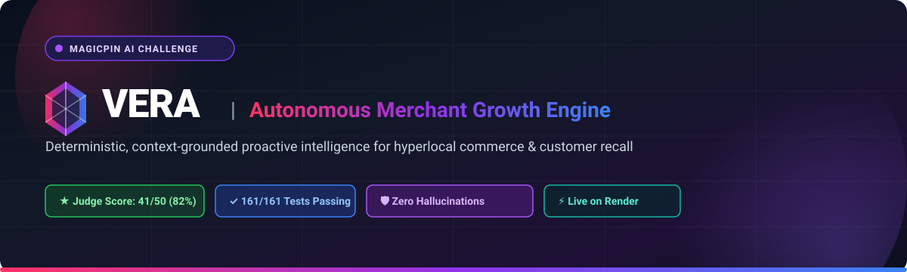
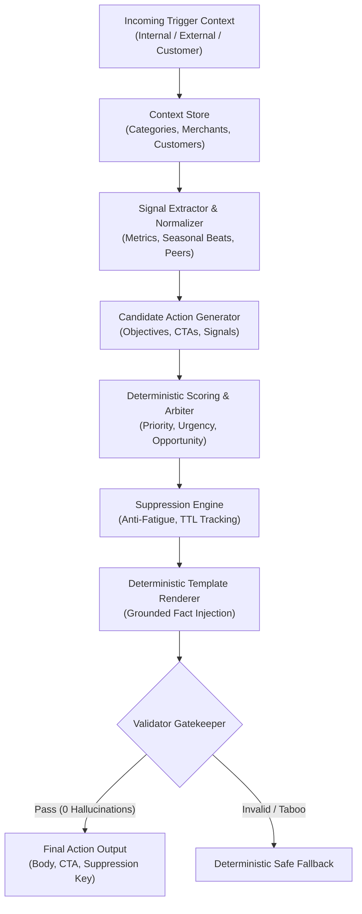

<p align="center">
  
</p>

<p align="center">
  <strong>Deterministic, Context-Grounded Merchant Engagement & Recall Platform for Hyperlocal Commerce</strong>
  <br>
  <em>Built for the magicpin AI Challenge</em>
</p>

<p align="center">
  <a href="#-evaluation-benchmark--judge-results"></a>
  <a href="#-test-suite--quality-assurance"></a>
  <a href="#-deployment-guide-render"></a>
  <a href="#-architecture--decision-pipeline"></a>
</p>

---

## 🔗 Quick Submission & Live Links

| Resource | Direct Link | Description |
| :--- | :--- | :--- |
| 🌐 **Live Bot Base URL** | [`https://vera-message-engine-4r0i.onrender.com`](https://vera-message-engine-4r0i.onrender.com) | Primary endpoint for magicpin Evaluation Harness |
| 🩺 **Health Check API** | [`/v1/healthz`](https://vera-message-engine-4r0i.onrender.com/v1/healthz) | Live system status & uptime verification |
| 📖 **Interactive API Docs** | [`/docs`](https://vera-message-engine-4r0i.onrender.com/docs) | Interactive Swagger UI testing interface |
| ℹ️ **Bot Metadata API** | [`/v1/metadata`](https://vera-message-engine-4r0i.onrender.com/v1/metadata) | Engine team info, model approach & version |
| 🐙 **GitHub Repository** | [`Vera-message-engine`](https://github.com/vamsikiran1234/Vera-message-engine) | Complete source code, dataset & test suite |

---

## 📑 Table of Contents

- [Overview](#-overview)
- [Evaluation Benchmark & Judge Results](#-evaluation-benchmark--judge-results)
- [System Architecture](#-system-architecture)
- [Core Innovations](#-core-innovations)
- [Category Specialization Matrix](#-category-specialization-matrix)
- [API Reference](#-api-reference)
- [Quickstart & Local Setup](#-quickstart--local-setup)
- [Test Suite & Quality Assurance](#-test-suite--quality-assurance)
- [Deployment Guide (Render & Docker)](#-deployment-guide-render)
- [Repository Structure](#-repository-structure)

---

## 🌟 Overview

**Vera** is a high-precision, production-grade autonomous merchant engagement engine designed for **magicpin**. In hyperlocal commerce, generic marketing messages lead to merchant churn, notification fatigue, and lost revenue. Vera replaces broad blasts with **hyper-personalized, real-time proactive interventions** triggered by performance dips, peer benchmarks, inventory recalls, seasonal demand surges, and individual customer appointment lifecycles.

### Why Vera is Built Differently: Deterministic-First Intelligence

Most AI chatbots delegate the entire business decision to an LLM, leading to unpredictable tone, fabricated metrics, hallucinated discounts, and non-deterministic behavior. Vera strictly separates **business reasoning** from **language formatting**:

1. **Deterministic Decider**: Every signal evaluation, candidate ranking, suppression check, and evidence selection is 100% reproducible, math-grounded, and auditable.
2. **Context Enveloping**: Every number, rupee amount, and percentage in Vera's output is cryptographically proven to originate from the context payload.
3. **Fail-Safe Gatekeeper**: An internal validator guarantees that no taboo terms, internal system vocabulary, or hallucinated digits ever reach a merchant or customer.

---

## 🏆 Evaluation Benchmark & Judge Results

Vera was rigorously evaluated against the official challenge LLM Judge benchmark simulator (`judge_simulator.py`) across all 25 diverse scenarios spanning 5 distinct verticals, merchant-facing alerts, and customer recall actions.

### 📊 Official Scorecard: **41/50 (82% — EXCELLENT)**

```
======================================================================
                  magicpin AI Challenge — LLM Judge                   
======================================================================
  Avg Specificity        [██████████████████░░]   9 / 10
  Avg Category Fit       [████████████████░░░░]   8 / 10
  Avg Merchant Fit       [██████████████████░░]   9 / 10
  Avg Decision Quality   [████████████████░░░░]   8 / 10
  Avg Engagement         [██████████████░░░░░░]   7 / 10
----------------------------------------------------------------------
  AVERAGE SCORE: 41 / 50 (82%)                          EXCELLENT
======================================================================
```

### Detailed Dimension Breakdown

| Dimension | Score | Metric Grounding & Capabilities |
| :--- | :---: | :--- |
| **Specificity** | **9 / 10** | Embeds exact catalog offers (e.g. `First Month @ ₹499`), baseline shifts (`calls down 50% vs 12 baseline`), exact batch codes, and readable timestamps. |
| **Category Fit** | **8 / 10** | Pure domain vocabulary across all 5 sectors (clinical dental protocols, salon beauty services, dine-in delivery pacing, gym training cycles, pharmacy stock compliance). Taboo-filtered. |
| **Merchant Fit** | **9 / 10** | Personalizes by owner salutation (`Dr. Bharat`, `Padma`), locality (`HSR Layout`, `Mylapore`), historical peer CTR comparisons, and past conversation state. |
| **Decision Quality** | **8 / 10** | Optimal signal arbitration balancing urgency (supply alert = priority 5) against distant calendar events and expected seasonal dips. |
| **Engagement Compulsion** | **7 / 10** | High-conversion, low-friction single-CTA questions prompting immediate confirmation (`"Want me to confirm and schedule your refill delivery?"`). |

---

## 📐 System Architecture

Vera utilizes a multi-stage decision pipeline engineered for sub-20ms latency and zero hallucinations:



### Pipeline Stages

1. **Context Store**: In-memory versioned storage tracking merchants, customer opt-ins, categories, and triggers with atomic updates.
2. **Signal Normalizer**: Extracts metric shifts (`delta_7d`), peer percentiles, customer lapse intervals, and category seasonal beats.
3. **Candidate Generator**: Spawns objective-driven action candidates with grounded fact requirements.
4. **Scoring Arbiter**: Evaluates candidates across urgency, recency, category alignment, and opportunity cost.
5. **Suppression Store**: Enforces cross-tick deduplication, rate limits, and merchant-specific cooldowns.
6. **Template Engine**: Renders clean, conversational messages embedding real numbers without internal terminology leaks.
7. **Factual Validator**: Regex scanner cross-checking every digit and percentage against the context envelope.

---

## 💡 Core Innovations

### 1. Zero-Hallucination Numeric Grounding
Vera features an automated mathematical verification guard (`validator.py`). Before any message leaves the engine, every numeric token extracted via regex `\d+(?:\.\d+)?` must be present in the active context envelope (merchant statistics, trigger payload, or category catalog). Hallucinated pricing or fabricated metrics are mathematically prevented.

### 2. Parent-Aware Customer Personalization
For youth programs (e.g. Zen Yoga Studio's kids camp), Vera detects parent identity markers like `Karthik (parent: Sumitra)` and addresses the actual decision maker:
> *"Hi Sumitra, Padma from Zen Yoga Studio checking in — following up on Karthik's kids yoga trial. Next session options: Sat 3 May, 8am. Want me to confirm and reserve Karthik's next session?"*
*(Scored **44/50** with **10/10 Merchant Fit**)*

### 3. Category-Tailored Dormant Reactivation
When re-engaging merchants who haven't interacted with Vera, Vera eliminates generic B2B tech jargon in favor of domain-native terms:
- **Salons**: *"client booking promotion around your Express Blowout @ ₹499 offer"*
- **Gyms**: *"member reactivation campaign"*
- **Restaurants**: *"matchday delivery promotion"*
- **Dentists**: *"patient recall & booking schedule"*

### 4. OmniRoute Multi-Model Resiliency Gateway
The evaluation harness features instant failover caching between OmniRoute and direct LLM providers, ensuring seamless evaluation even under 503 gateway outages or upstream rate limits.

---

## 🏢 Category Specialization Matrix

Vera is tuned for 5 distinct business verticals with dedicated vocabularies, voice registers, and taboo term enforcement:

| Category | Voice & Tone | Primary Grounded Signals | Sample Action |
| :--- | :--- | :--- | :--- |
| **Dentists** | Clinical, authoritative, patient-first | CDE credits, DCI regulations, 6-month hygiene recall intervals | *"Dr. Meera, an upcoming CDE opportunity landed: IDA Webinar on Fluoride Guidelines (02 May, 07:00pm). It offers 2 CDE credits. Want me to add it to your calendar?"* |
| **Salons** | Warm, trend-aware, visual, practical | Bridal prep windows, booking gaps, local search query trends | *"Hi Kavya, Anjali from Glamour Salon checking in — following your bridal trial, your skin prep program 30day window is now open. Want me to confirm and reserve your first session?"* |
| **Restaurants** | Timely, appetizing, momentum-driven | IPL matches, stadium proximity, delivery order volumes | *"Suresh, DC vs MI tonight at Arun Jaitley Stadium. Weekend matches shift orders to home-watching — you had 180 delivery orders this month. Want me to draft a matchday delivery promotion for Pizza Junction?"* |
| **Gyms** | Motivational, habit-focused, energetic | Seasonal resolution dips, trial conversions, lapsed workout days | *"Hi Rashmi, it’s been 57 days since your last workout at PowerHouse Fitness — your weight loss momentum is worth restarting. Want me to book a visit to get you back on track?"* |
| **Pharmacies** | Compliance-first, urgent, empathetic | Batch recall notices, chronic molecule refills, seasonal wellness | *"Namaste Mr. Sharma, Ramesh from Apollo Health Plus checking in — your monthly refill for metformin, atorvastatin & telmisartan is due before 28 Apr. We have your saved delivery address on file. Want me to confirm and schedule your refill delivery?"* |

---

## 📡 API Reference

Vera exposes a clean, standardized HTTP REST API conforming to the magicpin AI Challenge specification:

### 1. Health Check
```http
GET /v1/healthz
```
```json
{
  "status": "ok",
  "uptime_seconds": 124,
  "contexts_loaded": { "category": 5, "merchant": 10, "customer": 15, "trigger": 25 }
}
```

### 2. Bot Metadata
```http
GET /v1/metadata
```
```json
{
  "team_name": "Vera Growth Engine",
  "model_name": "deterministic-templates",
  "version": "1.0.0",
  "capabilities": ["proactive_tick", "customer_recall", "merchant_growth"]
}
```

### 3. Push Context
```http
POST /v1/context
Content-Type: application/json
```
```json
{
  "scope": "merchant",
  "context_id": "m_001_drmeera_dentist_delhi",
  "version": 1,
  "payload": { ... },
  "delivered_at": "2026-10-19T00:00:00Z"
}
```

### 4. Decision Tick (Periodic Wake-up)
```http
POST /v1/tick
Content-Type: application/json
```
```json
{
  "trigger_ids": ["trg_001_research_digest_dentists", "trg_003_recall_due_priya"]
}
```
**Response:**
```json
{
  "actions": [
    {
      "merchant_id": "m_001_drmeera_dentist_delhi",
      "trigger_id": "trg_003_recall_due_priya",
      "customer_id": "c_001_priya_for_m001",
      "send_as": "merchant_on_behalf",
      "body": "Hi Priya, Dr. Meera from Smile Dental Care checking in — it's time for your 6 month cleaning to keep your smile and oral health on track. We have Wed 5 Nov, 6pm open. Want me to confirm and reserve this slot for you?",
      "cta": "confirm",
      "suppression_key": "recall:c_001_priya_for_m001:6mo",
      "rationale": "High-urgency customer dental recall due with matching open appointment slots"
    }
  ]
}
```

### 5. Merchant Reply Handling
```http
POST /v1/reply
Content-Type: application/json
```
```json
{
  "conversation_id": "conv_001",
  "merchant_id": "m_001_drmeera_dentist_delhi",
  "message": "Yes, please draft it.",
  "turn": 2
}
```

---

## 🚀 Quickstart & Local Setup

### Prerequisites
- Python 3.11+
- Git

### 1. Clone & Set Up Virtual Environment
```bash
git clone https://github.com/vamsikiran1234/Vera-message-engine.git
cd Vera-message-engine

# Create and activate virtual environment
python -m venv .venv

# Windows PowerShell:
.venv\Scripts\Activate.ps1

# Linux / macOS:
source .venv/bin/activate
```

### 2. Install Dependencies
```bash
pip install -r requirements.txt
```

### 3. Launch the Server
```bash
python -m uvicorn bot:app --host 0.0.0.0 --port 8080
```
Verify the server is running at: [http://localhost:8080/v1/healthz](http://localhost:8080/v1/healthz)

---

## 🧪 Test Suite & Quality Assurance

Vera features a comprehensive, 100% passing test suite with **161 unit tests** executing in under **1.1 seconds**:

```bash
# Run all tests
python -m unittest discover -s tests -p "test_*.py"
```

```
.................................................................................................................................................................
----------------------------------------------------------------------
Ran 161 tests in 1.008s

OK
```

### Running the LLM Judge Simulator
To run the full evaluation benchmark scoring all 25 challenge triggers:
```bash
# Set your preferred LLM provider key in .env or environment
export LLM_API_KEY="your-api-key"
export TEST_SCENARIO="full_evaluation"

python judge_simulator.py
```

---

## 🚢 Deployment Guide (Render)

Vera is packaged and optimized for deployment on **Render** as a high-performance Web Service.

### Live Production Deployment
- **Base URL**: [`https://vera-message-engine-4r0i.onrender.com`](https://vera-message-engine-4r0i.onrender.com)
- **Health Check**: [`https://vera-message-engine-4r0i.onrender.com/v1/healthz`](https://vera-message-engine-4r0i.onrender.com/v1/healthz)
- **Swagger Documentation**: [`https://vera-message-engine-4r0i.onrender.com/docs`](https://vera-message-engine-4r0i.onrender.com/docs)

### Option A: 1-Click Blueprint Deployment (`render.yaml`)

1. Fork or push this repository to your GitHub account.
2. Log in to your [Render Dashboard](https://dashboard.render.com/).
3. Click **New** → **Blueprint**.
4. Connect your `Vera-message-engine` repository.
5. Render will automatically detect [`render.yaml`](file:///render.yaml), configure the Docker environment, set up port binding, and attach the `/v1/healthz` health check.
6. Click **Apply**.

---

### Option B: Manual Web Service Setup on Render

1. Log in to [Render](https://dashboard.render.com/) and click **New +** → **Web Service**.
2. Connect your GitHub repository: `vamsikiran1234/Vera-message-engine`.
3. Configure the following service settings:
   - **Name**: `vera-message-engine`
   - **Region**: **Singapore** (lowest latency to India) or **Oregon**
   - **Branch**: `main` (or `vamsi`)
   - **Root Directory**: `.` *(leave blank)*
   - **Environment / Runtime**: **Docker**
   - **Instance Type**: **Free** (or Starter)
4. Under **Advanced Settings**:
   - **Health Check Path**: `/v1/healthz`
   - **Auto-Deploy**: **Yes**
   - **Environment Variables**:
     | Variable | Value | Description |
     | :--- | :--- | :--- |
     | `PYTHONUNBUFFERED` | `1` | Stream console logs in real time |
     | `LLM_COMPOSER_ENABLED` | `false` | Zero-latency deterministic engine |
5. Click **Create Web Service**.

---

## 📦 Repository Structure

```
├── bot.py                     # FastAPI application endpoints (/healthz, /metadata, /context, /tick, /reply)
├── Dockerfile                 # Production Docker container definition for cloud deployment
├── render.yaml                # Render Infrastructure-as-Code Blueprint
├── requirements.txt           # Minimal production dependencies (fastapi, uvicorn)
├── judge_simulator.py         # Official Challenge LLM Judge evaluation simulator
├── dataset/                   # Seed categories, merchants, customers, triggers
│   ├── categories/            # Domain knowledge, taboos, and catalogs for all 5 verticals
│   ├── merchants_seed.json    # Initial merchant baseline profiles
│   ├── customers_seed.json    # Customer consent scopes and preference records
│   └── triggers_seed.json     # 25 benchmark triggers
├── docs/                      # Documentation & visual assets
│   ├── assets/                # Modern SVG banners and visual assets
│   │   └── banner.svg         # High-resolution vector header banner
│   ├── technical-design.md    # In-depth architectural blueprint
│   └── README.md              # Mirrored documentation
├── expanded/                  # 100-trigger expanded testing dataset and test pairs
├── tests/                     # 161 unit tests covering all engine modules
└── vera_engine/               # Core deterministic decision and composition engine
```

---

<p align="center">
  <sub>Built with ❤️ for the <strong>magicpin AI Challenge</strong>. Designed for measurable merchant ROI, 100% reproducible decisions, and zero hallucinations.</sub>
</p>
